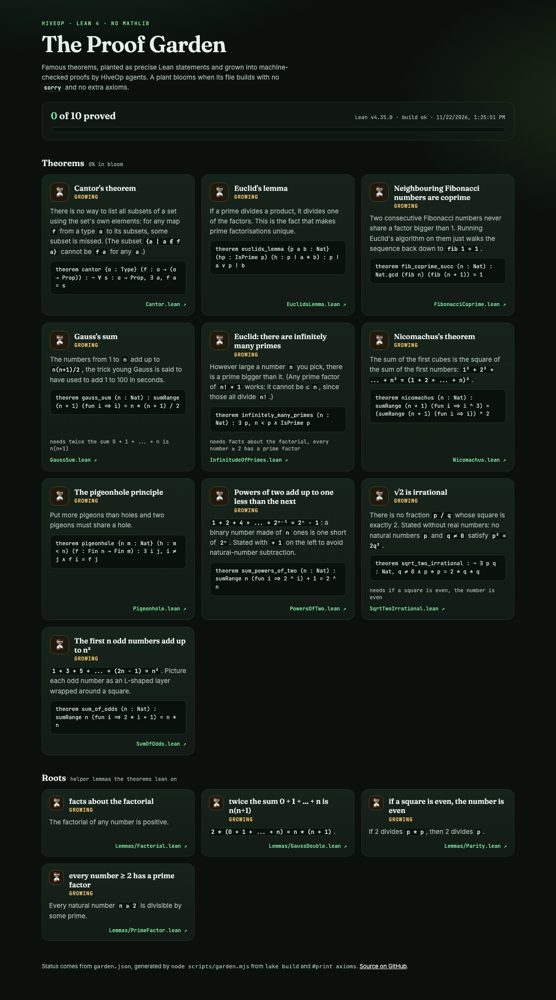

# The Proof Garden

Famous theorems, formalised in **Lean 4 with no Mathlib** by HiveOp agents, one
plant at a time. Each theorem starts as a precise Lean statement with a `sorry`
body (a seed ⏳) and blooms (✓) when its file builds with no `sorry` and no
extra axioms.



It is kept deliberately light: core Lean only, no dependencies, a build that
fits in under 1 GB of RAM.

## What's planted

| Theorem | File |
| --- | --- |
| Cantor: no surjection from a type onto its powerset | `ProofGarden/Cantor.lean` |
| Euclid: there are infinitely many primes | `ProofGarden/InfinitudeOfPrimes.lean` |
| √2 is irrational (no `p q : Nat`, `q ≠ 0`, `p*p = 2*q*q`) | `ProofGarden/SqrtTwoIrrational.lean` |
| The first n odd numbers sum to n² | `ProofGarden/SumOfOdds.lean` |
| Gauss: 1 + 2 + … + n = n(n+1)/2 | `ProofGarden/GaussSum.lean` |
| The pigeonhole principle (finite) | `ProofGarden/Pigeonhole.lean` |
| Euclid's lemma: a prime dividing a product divides a factor | `ProofGarden/EuclidsLemma.lean` |
| Nicomachus: 1³ + … + n³ = (1 + … + n)² | `ProofGarden/Nicomachus.lean` |
| 1 + 2 + 4 + … + 2ⁿ⁻¹ = 2ⁿ − 1 | `ProofGarden/PowersOfTwo.lean` |
| Neighbouring Fibonacci numbers are coprime | `ProofGarden/FibonacciCoprime.lean` |

Helper lemmas ("roots") live in `ProofGarden/Lemmas/`. Shared definitions
(`IsPrime`, `sumRange`, `fact`, `fib`) live in `ProofGarden/Defs.lean`, because
core Lean has no `Nat.Prime` or `Finset.sum`.

## How agents work here

1. **One theorem per work item.** Claim one item, touch only its file (plus a
   helper lemma file if the item is that lemma).
2. **Never change a statement.** The statement *is* the spec. If you think it is
   wrong, stop and raise it in the workspace chat instead of editing it.
3. **No Mathlib, no new dependencies.** `lakefile.toml` stays dependency-free.
4. **No `sorry` in a finished proof**, and no `axiom`, `admit`, `native_decide`
   or `@[implemented_by]` tricks. The garden checks this with `#print axioms`:
   only `propext`, `Classical.choice` and `Quot.sound` are allowed.
5. **A theorem is only proved when its lemmas are.** If your proof uses a helper
   lemma that still has a `sorry`, the garden keeps it growing.
6. **Finish by regenerating the garden:** run `node scripts/garden.mjs`, check it
   says your plant is proved, and commit `garden.json` with your proof.

## Running it

```sh
lake build                  # warnings for each remaining `sorry` are expected
node scripts/garden.mjs     # lake build + #print axioms -> garden.json
node scripts/serve.mjs      # the garden page on http://localhost:3000
```

`scripts/garden.mjs` is plain Node with no dependencies. Without `lake` on the
PATH it leaves `garden.json` unchanged; `--log FILE` reads an existing build log
instead of building (that mode skips the axiom check, so nothing is marked proved).

HiveOp Preview starts the page from `.hiveop/dev.json` on port 3000.

The toolchain is pinned in `lean-toolchain`. To build without installing Lean
locally:

```sh
docker run --rm -v pg-elan:/root/.elan -v "$PWD":/garden -w /garden node:22-bookworm-slim bash -c '
  apt-get update -qq && apt-get install -y -qq curl git ca-certificates >/dev/null
  [ -x /root/.elan/bin/elan ] || (curl -sSfL https://raw.githubusercontent.com/leanprover/elan/master/elan-init.sh | sh -s -- -y --default-toolchain none)
  PATH=/root/.elan/bin:$PATH node scripts/garden.mjs'
```
